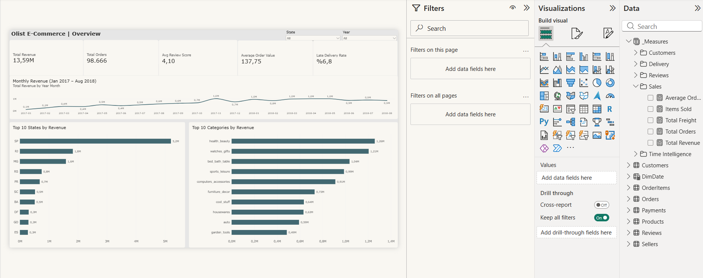
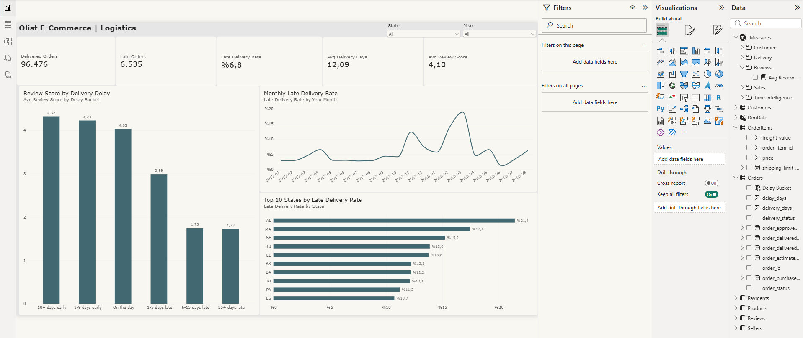
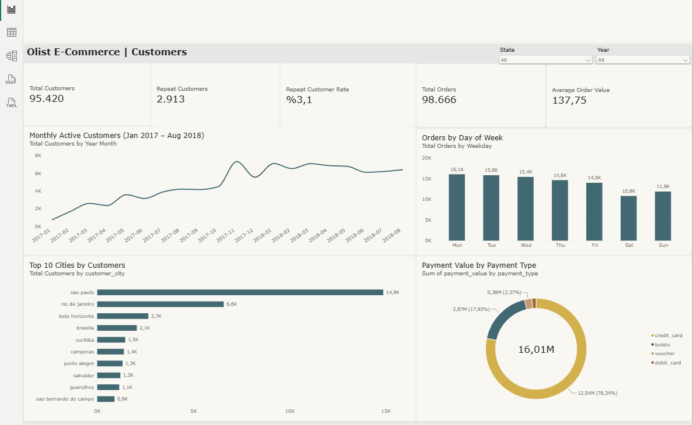
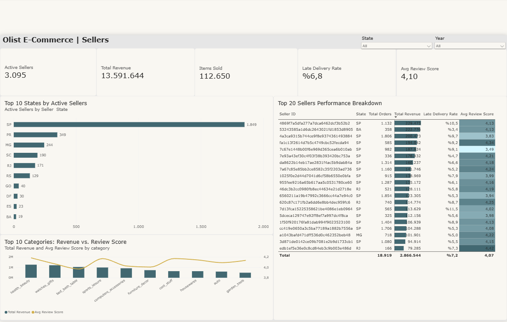
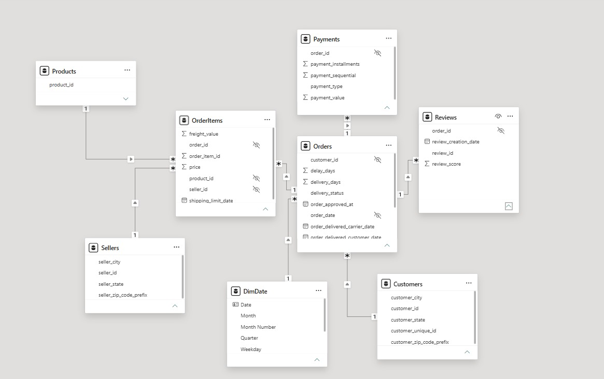

# Olist E-Commerce Analytics | Power BI Portfolio Project

Brezilya'daki küçük ve orta ölçekli işletmeleri büyük pazar yerlerine bağlayan e-ticaret aracı platformu **Olist**'in 2016–2018 yılları arasındaki ~100.000 siparişlik gerçek veri seti üzerinde gerçekleştirilmiş uçtan uca İş Zekâsı (Business Intelligence) ve Veri Analitiği projesidir.

Proje; ham verinin **Power Query (M)** ile temizlenmesi, **Star Schema** veri modelinin kurulması, **DAX** ölçülerinin (`TREATAS`, `CALCULATE`, `SAMEPERIODLASTYEAR`) yazılması ve 4 ana iş sorusuna yanıt veren interaktif bir **Power BI** raporunun tasarlanmasını kapsar. Versiyon kontrolü için Power BI Project (`.pbip`) formatında yapılandırılmıştır.

---

## 🎯 Temel İş Soruları ve Ana Bulgular (Executive Summary)

### 1. Genel Satış Performansı (`Overview`)
* **Toplam Hacim:** İncelenen dönemde **98.666** tekil siparişte **112.650** ürün satılmış ve kargo hariç **13,59 Milyon R$** ciro elde edilmiştir (Ortalama Sepet Tutarı: **137,75 R$**).
* **Büyüme ve Bölgesel Dağılım:** Ocak 2017 – Ağustos 2018 arasında aylık ciro istikrarlı bir büyüme sergilemiştir. Ciroda **São Paulo (SP)**, **Rio de Janeiro (RJ)** ve **Minas Gerais (MG)** ilk 3 sırayı alırken; en çok gelir getiren kategoriler `health_beauty`, `watches_gifts` ve `bed_bath_table` olmuştur.

### 2. Teslimat Gecikmelerinin Müşteri Memnuniyetine Etkisi (`Logistics`)
* **Kritik Kırılma Eşiği:** Teslim edilen **96.476** siparişin **%6,8'i (6.535 sipariş)** tahmini teslim gününden sonra müşteriye ulaşmıştır.
* **Memnuniyet Çöküşü:** Zamanında teslim edilen siparişlerde ortalama müşteri puanı **4,29 / 5,00** iken, geç teslim edilen siparişlerde bu oran **2,27**'ye düşmektedir:
  * **Tam gününde veya erken teslim:** `4,03 – 4,32` puan
  * **1–5 gün gecikme:** `2,99` puan
  * **6–15 gün gecikme:** `1,75` puan
* **Dönemsel ve Bölgesel Darboğaz:** Kasım 2017 (Black Friday) döneminde gecikme oranı **%12**'yi aşmış, Şubat–Mart 2018'de ise **~%19** ile zirve yapmıştır. En yüksek gecikme oranları **AL (%21,4)**, **MA (%17,4)** ve **SE (%15,2)** eyaletlerindedir.

### 3. Müşteri Davranışı ve Elde Tutma Oranı (`Customers`)
* **Düşük Tekrar Satın Alma (Retention):** Platform **95.420** tekil müşteriye (`customer_unique_id`) ulaşmasına rağmen, birden fazla sipariş veren müşteri sayısı **2.913 (%3,1)** seviyesindedir. Büyüme neredeyse tamamen yeni müşteri kazanımı üzerinden gerçekleşmiştir.
* **Alışveriş ve Ödeme Alışkanlığı:** Siparişler hafta içi (**Pazartesi: 16,1K – Salı: 15,8K**) yoğunlaşmakta, hafta sonu (**Cumartesi: 10,8K**) düşmektedir. Toplam ödeme hacminin **%78,34'ü kredi kartı**, **%17,92'si ise Boleto** ile yapılmıştır.

### 4. Satıcı Performansı ve Kalite Kontrolü (`Sellers`)
* **Coğrafi ve Gelir Yoğunlaşması:** **3.095** aktif satıcının **1.849'u (~%60)** São Paulo (SP) eyaletindedir. En yüksek ciro yapan **ilk 20 satıcı (%0,6)**, **2,87 Milyon R$** ile toplam platform cirosunun **%21'inden fazlasını** tek başına üretmektedir.
* **Operasyonel Risk:** İlk 5 büyük satıcı içinde yer almasına rağmen `%9,1 – %9,7` gecikme oranıyla çalışan ve müşteri puanı `3,49 – 3,83` seviyesine düşen satıcılar tespit edilmiştir.

---

## 📊 Dashboard Ekran Görüntüleri

### 1. Overview (Genel Bakış)


### 2. Logistics (Teslimat ve Memnuniyet Analizi)


### 3. Customers (Müşteri ve Ödeme Analizi)


### 4. Sellers (Satıcı Performansı)


---

## 🗂️ Veri Modeli (Star Schema)

8 ayrı tablo Power Query'de temizlenmiş, kategori çevirileri `Products` tablosuna birleştirilmiş (`Merge Queries`) ve özel bir `DimDate` takvim tablosu ile **Star Schema** mimarisinde modellenmiştir:



### Metodolojik Kararlar ve Veri Temizliği
* **Ciro Tanımı:** `Total Revenue`, kargo bedeli (`freight_value`) hariç tutularak yalnızca ürün satış fiyatları (`OrderItems[price]`) üzerinden hesaplanmıştır.
* **Gecikme Tanımı:** Tahmini teslim tarihi (`order_estimated_delivery_date`) gün bazında gerçek teslim tarihiyle karşılaştırılmış; tahmini günden sonraki teslimatlar `Late` olarak sınıflandırılmıştır.
* **Eksik Ayların Filtrelenmesi:** Veri setinde tam ay verisi bulunmayan 2016 sonu ve Eylül–Ekim 2018 ayları, aylık trend grafiklerinde yanıltıcı düşüş göstermemesi için `Jan 2017 – Aug 2018` aralığıyla sınırlandırılmıştır.
* **Tekil Müşteri Takibi:** Her siparişte yeniden üretilen `customer_id` yerine gerçek müşteriyi temsil eden `customer_unique_id` kullanılmıştır.

---

## 🧮 Öne Çıkan DAX Ölçüleri

```dax
-- Filtre yönü sınırlamasını çift yönlü (Both) ilişki kullanmadan aşan yorum puanı ölçüsü
Avg Review Score = 
CALCULATE (
    AVERAGE ( Reviews[review_score] ),
    TREATAS ( VALUES ( OrderItems[order_id] ), Orders[order_id] )
)

-- Birden fazla sipariş veren tekrar eden müşterilerin hesabı
Repeat Customers = 
COUNTROWS (
    FILTER (
        CALCULATETABLE ( VALUES ( Customers[customer_unique_id] ), OrderItems ),
        CALCULATE ( DISTINCTCOUNT ( OrderItems[order_id] ) ) > 1
    )
)

-- Teslim edilen siparişler üzerinden gecikme oranı
Late Delivery Rate = DIVIDE ( [Late Orders], [Delivered Orders] )
```

---

## 🚀 Projeyi Yerelde Çalıştırma

1. [Kaggle - Brazilian E-Commerce Public Dataset by Olist](https://www.kaggle.com/datasets/olistbr/brazilian-ecommerce) sayfasından veri setini indirin ve CSV dosyalarını `data/raw/` klasörüne çıkarın.
2. `powerbi/olist-ecommerce-analytics.pbip` dosyasını **Power BI Desktop** ile açın.
3. Üst menüden **Home → Transform data → Data source settings → Change Source** adımıyla dosya yolunu kendi bilgisayarınızdaki `data/raw/` klasörüne yönlendirip **Refresh** butonuna basın.